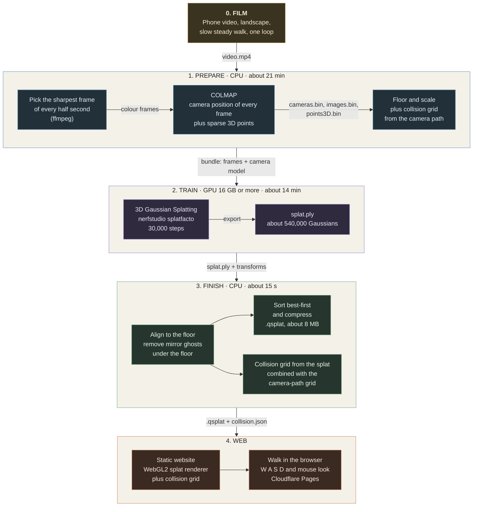
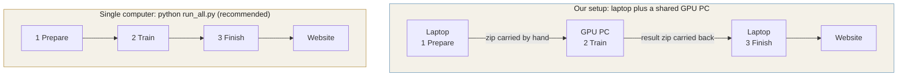

# NammaSpace

Walk through a real room in your browser, built from one phone video.

Built by Matrix (Chepuri Dathatreya) for IIT Techfest 2026.
**Project page, live viewer, demo video and technical report:** https://namma-space-documentation.pages.dev/

## The problem

Photos and videos show a space, but you cannot walk through them, check the gaps, or find the thing you came for. 3D scanners can, but they cost too much for an ordinary home, shop or hall.

## What NammaSpace does

- Turns **one phone video** into a 3D Gaussian splat of the real room, shown as a web page. Nothing to install.
- Lets you **walk** it with W A S D. Walls and furniture stop you, using a collision grid built from the scan.
- Lets you **search places** (TV, fridge, bed...) and shows them with labels, a card and pins on a live map.
- Draws a **walkable route** to the place you pick and can walk or fly you there.
- Runs as a repeatable **four-step pipeline**, so a new space takes one video and some tagging.

Scenes so far: Room, Hallway and Bedroom, an early Bedroom, and a 4K Hallway and Bedroom scene with 14 tagged places.

## Progress

| When | What happened |
|---|---|
| Round 1 | Reconstruction and roaming submitted: abstract, demo video, web viewer and this repository. |
| 10 Nov | Qualified for Round 2 (places, search and routes). |
| After Round 1 | Training moved to free cloud GPUs with two notebooks, one for Google Colab and one for Kaggle. The lab GPU PC is no longer needed. |
| After Round 1 | New 4K capture, trained to 29.1 dB PSNR. |
| Round 2 | Points of interest, search, A* routes and a tagging tool (STEP 4) added to every scene. |

## Live demo

Open the project page above and click the Room scene. **W A S D** walk, **Shift** runs, **Space** jumps, **Esc** frees the mouse, **R** returns to the door, **M** shows the collision grid, **N** the live map, **/** searches places.

## How it works

One phone video goes in, a walkable 3D scene comes out. Every arrow is labelled with the file that moves along it.



### The same three stages on one machine or two

The stages never change. Only where they run, and whether you carry a zip by hand, changes.



| | Single computer | Our two-machine setup |
|---|---|---|
| Command | `python run_all.py --video my.mp4` | `STEP1_prepare_video.bat`, then `RUN_NEW_BUNDLE.sh` on the GPU PC, then `STEP3_finish_and_open_website.bat` |
| Needs | one NVIDIA GPU of 16 GB or more | a laptop for stages 1 and 3 and a GPU PC for stage 2 |
| Hand-off | none | a zip carried each way |
| Why we used it | | the laptop GPU has 6 GB, and the lab GPU PC is shared |

## Training on a free GPU (Colab and Kaggle)

Step 2 needs a GPU. Instead of owning one, you can train in a free cloud notebook. Both notebooks are in `namma_pipeline/remote/`:

| Notebook | GPU | Where the data goes |
|---|---|---|
| `NAMMA_STEP2_colab.ipynb` | free Colab T4 | bundle zip in a Drive folder named `namma`; the result is saved back there |
| `NAMMA_STEP2_kaggle.ipynb` | free Kaggle T4 (about 30 GPU hours a week) | bundle zip as a private Kaggle Dataset |

The workflow is: run `STEP1_prepare_video.bat` on your computer, upload the bundle zip it makes, run the notebook (30,000 steps, about 25 minutes on a T4), download the result zip into `3_PUT_REMOTE_RESULT_HERE`, then run `STEP3_finish_and_open_website.bat`. Set `ITERS = 2000` in the notebook for a quick test.

On the 4K scene both notebooks gave the same score (Kaggle 29.12 dB, Colab 29.12 dB), so results do not depend on the platform.

## Places, search and routes

The viewer shows named places (points of interest), searches them, and draws a walkable route to the one you pick. The route is A* on the same collision grid that stops you at walls, so it never crosses a blocked cell.

| In the viewer | How |
|---|---|
| Find a place | `/` or Ctrl+K and type; typos and other names such as "almirah" work |
| Pick a place | click its label or its pin on the map, or aim and press `E` |
| Go there | `G` walks the route, `F` flies there, `X` clears it |

**Data.** Places live in `site/assets/pois.json`, named by the `"pois"` key in `manifest.json`. A scene without that key works as before.

```json
{ "id": "fridge", "name": "Fridge", "aliases": ["refrigerator"], "category": "appliance",
  "x": -0.22, "y": 0.81, "z": -1.37, "description": "Refrigerator in the kitchen corner" }
```

`x`, `y`, `z` are metres (`y` is height). An optional `"stand": {"x": 0, "z": 0}` fixes where the visitor stands; otherwise the viewer picks a walkable spot about 1.2 m in front.

**Tagging (STEP 4).** Run `namma_pipeline/STEP4_tag_places.bat`. It opens the scene at `localhost:8766/?edit=1`. Aim the dot at an object, press `T`, type a name, then **Save to project**. The file is checked, the old one is backed up, and `pois.json` is written. You can also edit `pois.json` by hand.

**Code** (`namma_pipeline/viewer_template/`): `nav.js` pathfinding, `poi.js` search and spatial index, `poi_ui.js` labels, search box, route and map pins, `poi_editor.js` the tagging tool, `main.js` the viewer.

**Tests.** `node --test "test/*.test.js"` runs 35 checks on the real grids and place files (Node.js 21 or newer).

## Run it yourself

- **Just look:** open the project page.
- **View a scene locally:** `cd 01_room/site`, `python -m http.server 8766`, open http://localhost:8766/ (on Windows, double-click `START_WINDOWS.bat`).
- **Rebuild a scene on one machine:**

```bash
python run_all.py --check               # lists what is missing
python run_all.py --test                # bundled sample, 1,000 steps, proves the chain in minutes
python run_all.py --video my_walk.mp4   # your own video
```

One machine needs Linux (or WSL2), an NVIDIA GPU with 16 GB or more, CUDA 12.x, 20 GB of disk, `ffmpeg`, COLMAP 3.9+ and nerfstudio, plus `pip install -r requirements.txt` and `requirements-train.txt`. No such GPU? Use the notebooks above. Details, options and filming tips: [`docs/RUN_GUIDE.md`](docs/RUN_GUIDE.md) and [`docs/HARDWARE_AND_REMOTE_SETUP.md`](docs/HARDWARE_AND_REMOTE_SETUP.md).

Tested: STEP 1 and STEP 3 on Windows many times, STEP 2 on Linux and on Colab and Kaggle. Native Windows training was not tried, and `run_all.py --test` has not yet been run on a separate clean GPU machine.

## Results

| Scene | Folder | Gaussians | PSNR | SSIM | LPIPS |
|---|---|---:|---:|---:|---:|
| Room | [`01_room`](01_room) | 541,337 | 27.14 dB | 0.913 | 0.191 |
| Hallway and Bedroom | [`02_hallway_bedroom`](02_hallway_bedroom) | 650,654 | 26.46 dB | 0.874 | 0.244 |
| Early Bedroom | [`03_bedroom_early`](03_bedroom_early) | 700,000 shown | not evaluated | | |
| Hallway and Bedroom 4K | [`04_hallway_bedroom_4k`](04_hallway_bedroom_4k) | 393,733 | 29.12 dB | 0.912 | 0.144 |

Scores are measured on frames held out from training. Settings and timings: [`01_room/notes/TRAINING_REPORT.md`](01_room/notes/TRAINING_REPORT.md).

## Known limits

- Ceilings and areas the camera barely saw are rough or dark.
- Collision is a 2D floor grid. It does not model stairs or overhangs.
- Scale assumes a fixed phone height, not a measured reference.
- Places are tagged by hand, so each new scene needs a person for STEP 4.

More in section 10 of the [technical report](https://namma-space-documentation.pages.dev/report/).

## Repository layout

```
run_all.py             one command for the whole pipeline
test/                  sample scene and navigation and place tests
01_room/ ... 04_hallway_bedroom_4k/   one folder per scene (site/ and notes)
home/                  project overview page
documentation_site/    project page, technical report, results, roadmap
deploy/                publishes all scenes as one Cloudflare Pages site
namma_pipeline/
  scripts/             pipeline code
  remote/              training scripts and the Colab and Kaggle notebooks
  viewer_template/     the web viewer every scene is built from
docs/                  run guide, hardware, internals
```

One video makes one scene and one website. Videos, frames, zips, COLMAP databases and `namma_pipeline/runs/` are not in git because they are large.
